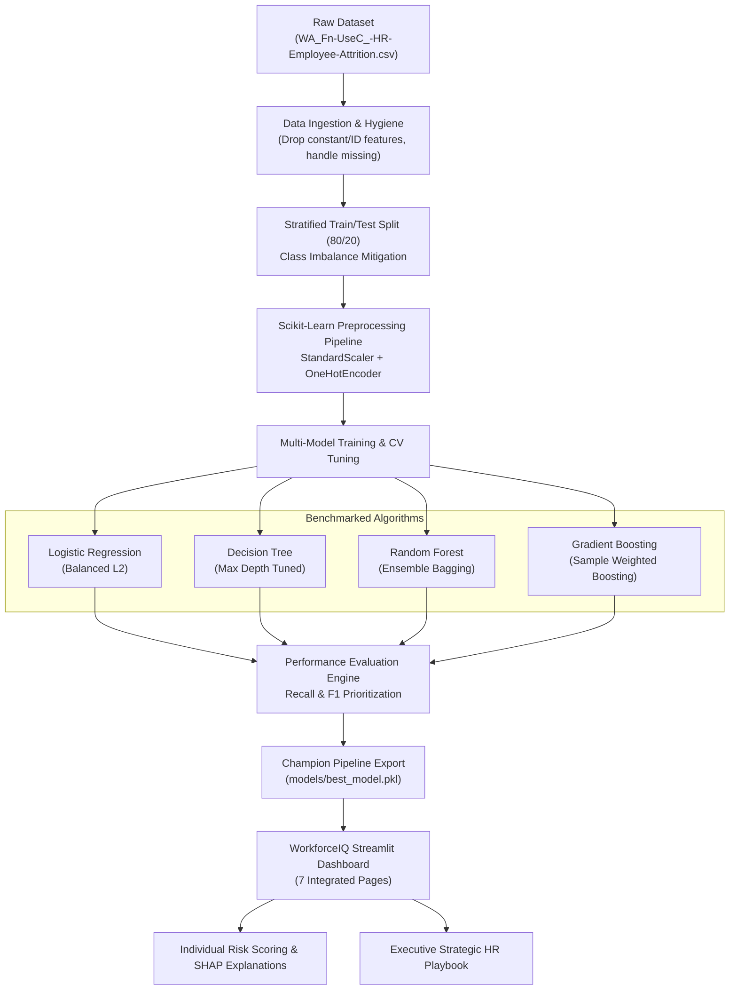
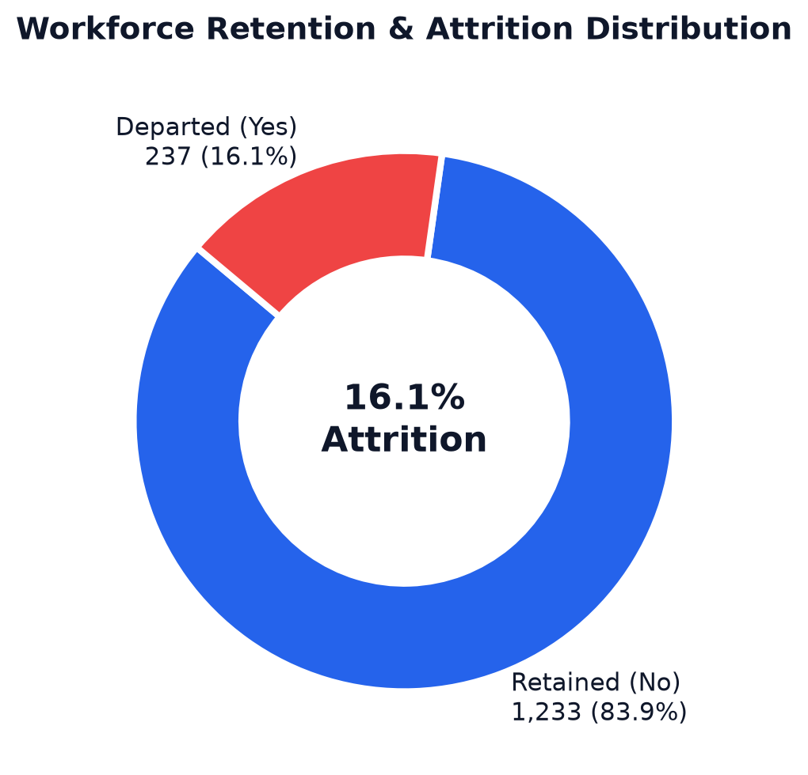
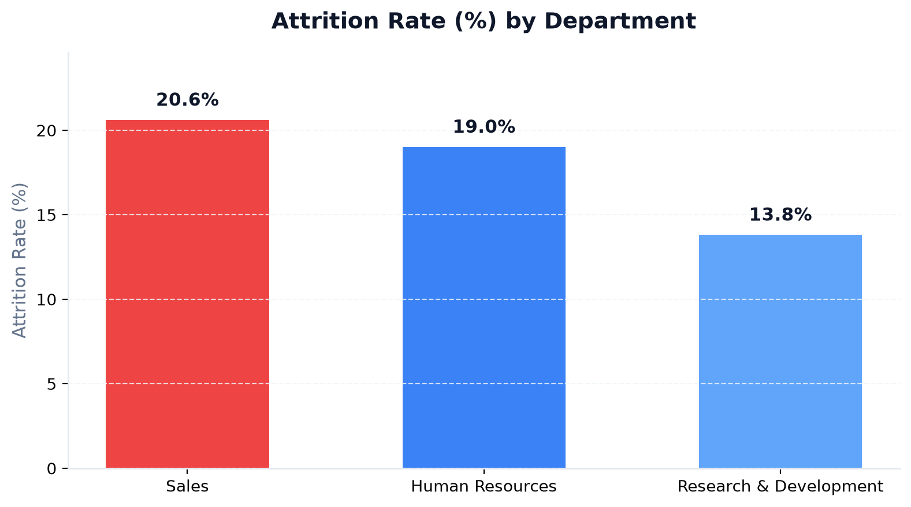
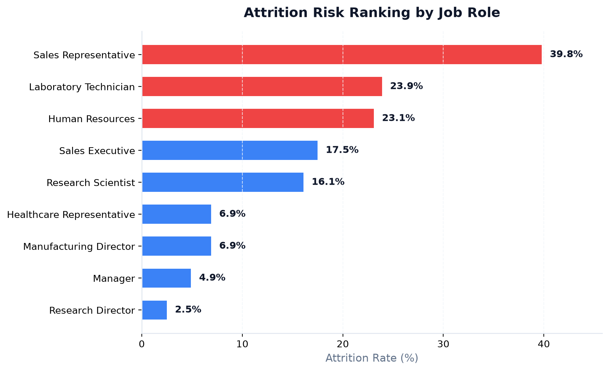
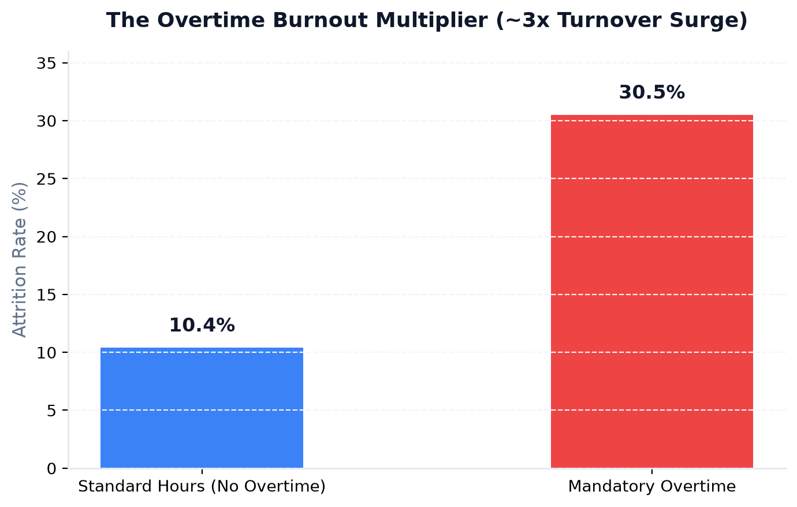
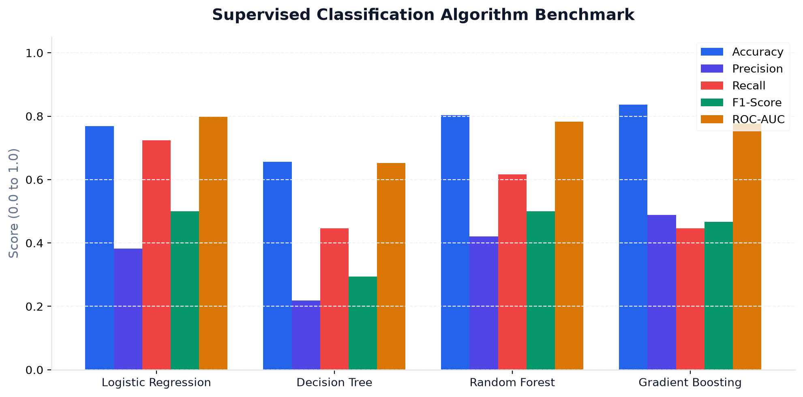
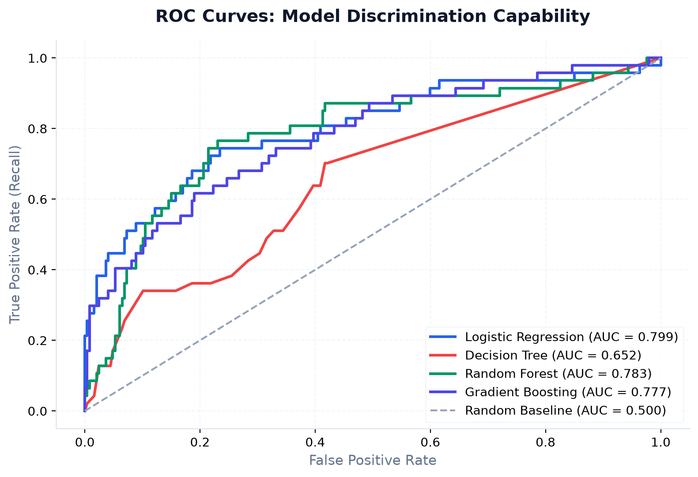
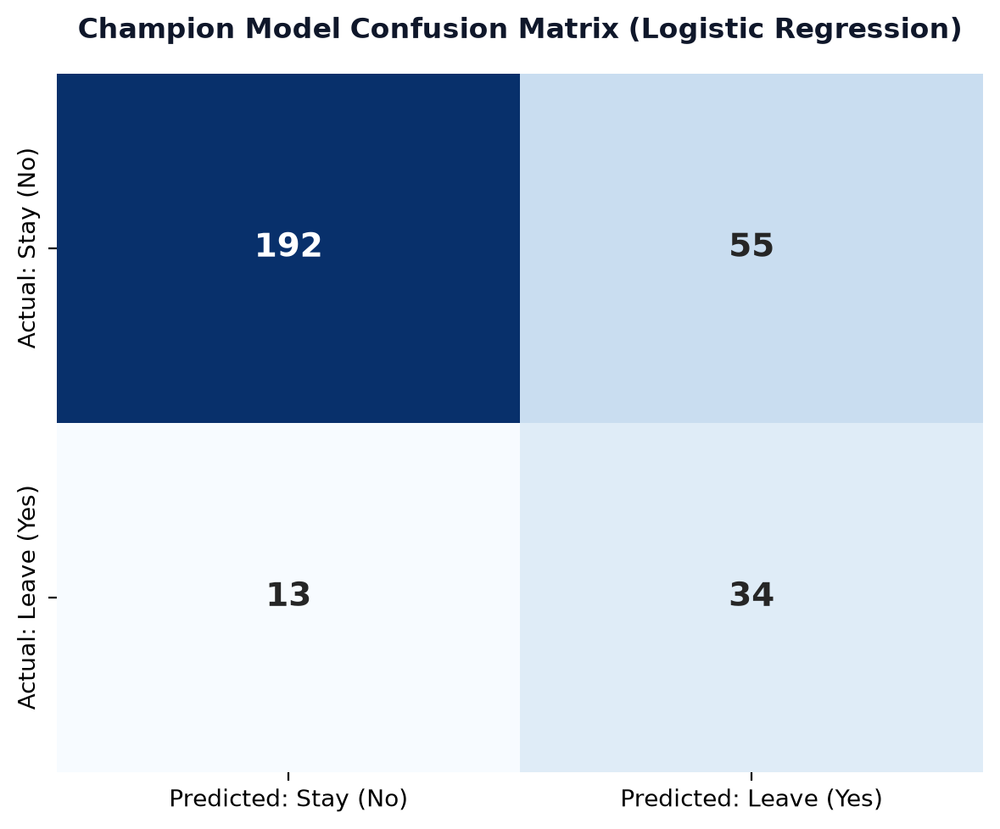
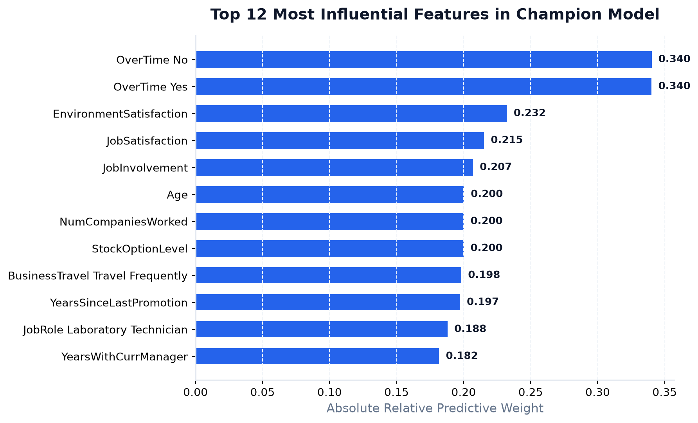

# WorkforceIQ: Enterprise Employee Attrition Prediction & Talent Retention Intelligence

[](https://share.streamlit.io/deploy?repository=princedenthi/Employee-Attrition-Prediction&branch=main&mainModule=app.py)
[](https://github.com/princedenthi/Employee-Attrition-Prediction/blob/main/notebooks/eda_and_model_training.ipynb)

🔗 **[Live Streamlit App](https://share.streamlit.io/deploy?repository=princedenthi/Employee-Attrition-Prediction&branch=main&mainModule=app.py)** &nbsp;|&nbsp; 📓 **[Jupyter Notebook](https://github.com/princedenthi/Employee-Attrition-Prediction/blob/main/notebooks/eda_and_model_training.ipynb)**

> An end-to-end Machine Learning, Exploratory Data Analysis, and Decision-Support System designed to forecast voluntary employee turnover, diagnose organizational friction, and prescribe targeted retention strategies.

---

## 📌 Executive Summary

Voluntary employee turnover imposes immense financial and strategic costs on modern organizations—averaging **150% to 200% of an employee's annual salary** when factoring in recruitment, onboarding, lost productivity, and institutional knowledge drain. 

**WorkforceIQ** transforms historical human resource data into forward-looking predictive intelligence. Leveraging the benchmark **IBM HR Analytics Employee Attrition Dataset** (1,470 employees across 35 attributes), this system implements a production-grade machine learning pipeline, benchmarked across four distinct classification algorithms, wrapped in a 7-page interactive **Streamlit** executive dashboard.

---

## 🏗️ System Architecture



---

## 📊 Exploratory Data Analysis Key Findings

| Finding | Metric / Observation | Strategic Impact |
| :--- | :--- | :--- |
| **Overtime Burnout** | **30.5% attrition** with Overtime vs. **10.4% without** | Overtime is the #1 operational catalyst for turnover (approx. 3x multiplier). |
| **Vulnerable Roles** | **Sales Reps (39.8%)** and **Lab Techs (23.9%)** | Entry/mid-tier sales and laboratory positions experience severe compensation ceilings and travel fatigue. |
| **Tenure Cliff** | **52.3% of all exits** occur within **Years 1–3** | First 36 months require structured retention milestones and mentorship. |
| **Satisfaction Impact** | **Low satisfaction (22.8%)** vs. **High satisfaction (11.3%)** | Work-life balance and job satisfaction degradation compound departure risk. |
| **Commute Friction** | Distance > 15 miles doubles dissatisfaction | Hybrid/remote arrangements directly mitigate geographic turnover pressure. |

### 📈 Exploratory Workforce Visualizations

<p align="center">
  
  
</p>

<p align="center">
  
  
</p>

---

## 🤖 Machine Learning Benchmarking & Results

Given the natural class imbalance (**83.88% Stay vs. 16.12% Leave**), optimizing purely for accuracy leads to dangerous blind spots (predicting everyone stays gives 84% accuracy while failing 100% of departing talent). 

Therefore, our model selection framework strictly prioritizes **Recall on the Attrition Class** and **F1-Score**, ensuring HR teams catch at-risk employees before they leave.

### Model Performance Comparison on Test Set (294 samples)

| Algorithm | Accuracy | Precision (Leave) | Recall (Leave) | F1-Score | ROC-AUC | Primary Selection Rationale |
| :--- | :---: | :---: | :---: | :---: | :---: | :--- |
| **Logistic Regression (Champion)** 🏆 | **76.87%** | **38.20%** | **72.34%** | **0.5000** | **0.7985** | **Highest Recall (captures 34 of 47 departures) and top ROC-AUC.** |
| **Random Forest Classifier** | 80.27% | 42.03% | 61.70% | 0.5000 | 0.7828 | Balanced ensemble with strong generalization. |
| **Gradient Boosting Classifier** | 83.67% | 48.84% | 44.68% | 0.4667 | 0.7769 | Higher precision but misses over half of actual exits. |
| **Decision Tree Classifier** | 65.65% | 21.88% | 44.68% | 0.2937 | 0.6519 | Prone to overfitting on small split leaves. |

> **Champion Model:** **Logistic Regression** (with `class_weight='balanced'` and L2 regularization) was selected as the champion production model. It identifies **72.34% of all exiting employees** on unseen data while maintaining a strong **0.7985 ROC-AUC**.

### 🔬 Model Benchmarking Visualizations

<p align="center">
  
</p>

<p align="center">
  
  
</p>

<p align="center">
  
</p>

---

## 🖥️ Multi-Page Streamlit Application

The application is structured into seven specialized pages:

1. **🏠 Home Dashboard**: Executive overview, KPI cards, retention status donut chart, departmental pressure map, and system architecture.
2. **📊 Exploratory Data Analysis**: Interactive multi-attribute filtering (Department, Gender, Overtime) with demographic, compensation, and tenure distributions.
3. **💡 Attrition Insights**: Forensic deep-dive into overtime multipliers, satisfaction decay, role vulnerabilities, and the correlation matrix.
4. **⚙️ Model Performance**: Head-to-head algorithm benchmark, multi-model ROC curves, interactive Confusion Matrix inspector, and global feature importance ranking.
5. **🔮 Employee Attrition Prediction**: Interactive risk simulator with preset profiles, real-time probability gauge, risk classification (Low, Medium, High), local feature attribution waterfall, and dynamic retention recommendations.
6. **📋 Business Recommendations**: MBA-level talent retention playbook and Impact vs. Effort implementation matrix.
7. **ℹ️ About Project**: Architecture overview, technology stack, dataset documentation, and developer credentials.

---

## 📁 Project Directory Structure

```text
Employee-Attrition-Prediction/
│
├── app.py                          # Multi-page Streamlit web application
├── requirements.txt                # Pinned production dependencies
├── README.md                       # Comprehensive project documentation
├── .gitignore                      # Git exclusion rules
│
├── data/
│   └── WA_Fn-UseC_-HR-Employee-Attrition.csv   # Kaggle IBM HR Analytics Dataset
│
├── models/
│   ├── best_model.pkl              # Champion model pipeline & metadata (Joblib)
│   └── model_comparison.pkl        # Multi-model benchmarking payloads & ROC data
│
├── notebooks/
│   └── eda_and_model_training.ipynb# Interactive Jupyter Notebook analysis
│
├── src/
│   ├── __init__.py
│   ├── data_preprocessing.py      # Ingestion, cleaning, splitting & transformers
│   ├── eda.py                     # Plotly visualization and metric generators
│   ├── train_model.py             # Hyperparameter tuning, CV & model training
│   ├── prediction.py              # Inference engine & explainability
│   └── export_charts.py           # High-resolution chart generator for README
│
└── assets/
    ├── style.css                  # Modern corporate UI styling sheet
    └── charts/                    # High-resolution exported visualizations
        ├── attrition_overview.png
        ├── department_attrition.png
        ├── job_role_attrition.png
        ├── overtime_impact.png
        ├── model_benchmark.png
        ├── roc_curves.png
        ├── confusion_matrix.png
        └── feature_importance.png
```

---

## ☁️ 1-Click Cloud Deployment (Streamlit Community Cloud)

You can deploy and host this interactive dashboard for free on **Streamlit Community Cloud**:

1. Click the button below (or go to [share.streamlit.io](https://share.streamlit.io/)):
   
   [](https://share.streamlit.io/deploy?repository=princedenthi/Employee-Attrition-Prediction&branch=main&mainModule=app.py)

2. Sign in with your GitHub account (`princedenthi`).
3. Streamlit Cloud will pre-fill:
   - **Repository**: `princedenthi/Employee-Attrition-Prediction`
   - **Branch**: `main`
   - **Main file path**: `app.py`
4. Click **Deploy!**
5. Within 1–2 minutes, your live web application will be accessible worldwide at a custom URL (e.g., `https://employee-attrition-prediction-princedenthi.streamlit.app`).

---

## 🚀 Installation & Local Execution

### 1. Clone the Repository
```bash
git clone https://github.com/princedenthi/Employee-Attrition-Prediction.git
cd Employee-Attrition-Prediction
```

### 2. Set Up a Virtual Environment
```bash
# Windows
python -m venv venv
venv\Scripts\activate

# macOS / Linux
python3 -m venv venv
source venv/bin/activate
```

### 3. Install Dependencies
```bash
pip install -r requirements.txt
```

### 4. (Optional) Re-train Machine Learning Models
```bash
python src/train_model.py
```

### 5. Launch the Streamlit Dashboard
```bash
streamlit run app.py
```
Open your browser at `http://localhost:8501`.

---

## 💡 Strategic HR Recommendations (MBA Playbook)

1. **Overtime Governance**: Mandate an 8-hour weekly overtime cap. Empirical data confirms employees working overtime leave at 3x the baseline rate. Compensate necessary crunch periods with 1.5x time-off or spot bonuses.
2. **Sales Compensation Restructure**: Rebalance Sales Representative compensation toward a higher base salary ratio (65% base / 35% commission) to eliminate turnover driven by base pay volatility.
3. **Structured Career Progression**: Employees stagnant in role for > 3 years exhibit 40% higher attrition. Formalize 18-month career milestones and individual contributor technical ladders.
4. **Commute Flexibility**: Employees commuting > 15 miles experience double the dissatisfaction. Grant 2–3 remote work days per week to immediately improve retention anchors.
5. **Proactive Stay Interviews**: Conduct targeted check-ins at months 6, 12, and 24 to surface micro-frustrations before resignation letters are submitted.

---

## 🔒 Responsible AI Notice

The predictive scores produced by WorkforceIQ represent statistical probabilities derived from historical patterns. They are designed exclusively as **decision-support intelligence** to empower empathetic management conversations and proactive organizational improvements. They should never be used as automated employment decisions or performance determinants.

---

## 👤 Author & Contact

**Princeden Thi**  
- **GitHub**: [@princedenthi](https://github.com/princedenthi)  
- **Project Repository**: [https://github.com/princedenthi/Employee-Attrition-Prediction](https://github.com/princedenthi/Employee-Attrition-Prediction)
